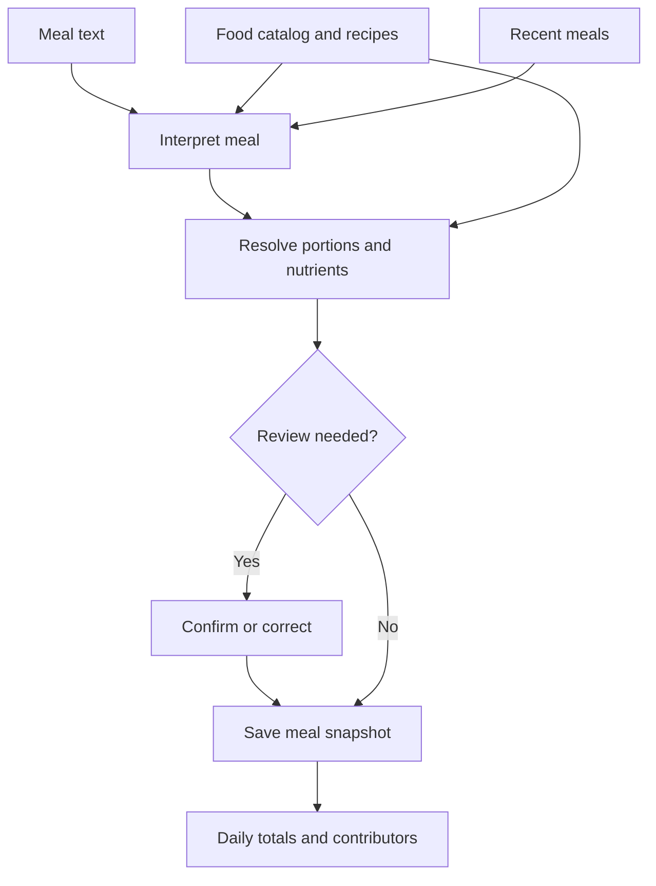

# Nutrimaxxlent

A local-first nutrition log with a chat interface. Describe what you ate, review the matched foods and amounts, and see calories, macros, micronutrients, and food groups over time.

> “Big serving of yesterday’s curry with rice and maybe 100 g minced meat.”

Chat uses your food catalog, saved recipes, and recent meals to interpret entries like this. It asks about ambiguous products or quantities and gives each meal a short name. The server calculates nutrients and saves the amounts used in each log, so refreshing the catalog keeps past totals intact.

## Try the demo

Install **Node.js 26**, **pnpm 12.14.0**, and **Docker Compose**. Run these commands from the repository root.

```sh
pnpm install --frozen-lockfile
cp .env.example .env # Only on first setup
docker compose up -d --wait
pnpm demo
```

Open **http://127.0.0.1:4173**, choose **+ Log**, and enter `1.5x carbonara, no pancetta, add peas` or `150 g cooked rice`. Click a nutrient on **Today** to see the foods that contributed to it.

The demo uses a fixed test provider and a small synthetic catalog in a temporary PostgreSQL database. It needs no model credentials or external food data. Stop it with Ctrl+C to discard the demo database.

## Set up your own log

Install the dependencies and start Docker Compose as shown above, then initialize your own log.

```sh
pnpm db:migrate
pnpm db:seed
pnpm data:refresh slv
npx @openai/codex login
pnpm provider:smoke
pnpm dev
```

Open **http://127.0.0.1:3000**. Choose **+ Log** for the selected date and try `äpple, kaffe`, or log a catalog item from Foods. For the built app, use `pnpm build` followed by `pnpm start`.

- **Catalog.** Import Livsmedelsverket (`slv`), USDA FoodData Central (`fdc`), or Swedish Open Food Facts (`off`) with `pnpm data:refresh <source>`. USDA imports use `unzip`. Open Food Facts imports need DuckDB and several gigabytes of disk space. [Sources, licenses and attribution](docs/data-sources.md)
- **Provider.** The default Codex adapter uses an active local CLI session. The connection test sends a synthetic food example. Chat sends the meal text and relevant context to the configured model. [Provider configuration and data flow](docs/llm-provider.md)
- **Backups.** Run `pnpm backup` with PostgreSQL 18 client tools installed. Restore the archive into a new database with `pg_restore --exit-on-error --dbname <database> <archive>`. Settings also offers a JSON export. [Data model](docs/data-model.md)

The app binds to localhost by default. Keep it local because this single-user setup has no app-level authentication. If you change `PORT` or the host used in the browser, update `ORIGIN` to match. If you change the Compose port or password, update `DATABASE_URL` too.

## Architecture

One SvelteKit app serves the UI and API. PostgreSQL stores the catalog, meal snapshots, recipes, and chat history.



Manual logging and chat use the same nutrition resolver and persistence code. Branded foods can use published labels and estimate missing nutrients from compatible ingredients when the available evidence is sufficient. The log tracks which values were estimated. [Architecture overview](docs/architecture/overview.md) · [API reference](docs/api.md) · [UI guide](docs/ui.md)

## Development

| Command               | Purpose                                                                                                                                                      |
| --------------------- | ------------------------------------------------------------------------------------------------------------------------------------------------------------ |
| `pnpm check`          | Check types, lint rules, and formatting.                                                                                                                     |
| `pnpm test`           | Run unit tests. Set `TEST_DATABASE_URL` to a migrated, seeded PostgreSQL test database for integration tests. The Open Food Facts fixture also needs DuckDB. |
| `pnpm test:e2e`       | Run browser tests with the synthetic catalog and a temporary PostgreSQL database. Install Chromium with `pnpm exec playwright install chromium`.             |
| `pnpm db:generate`    | Generate a migration after changing the schema.                                                                                                              |
| `pnpm provider:smoke` | Check the live model connection with a synthetic example.                                                                                                    |

The demo and browser tests use the database URL to create a temporary database. The role needs permission to create databases and install `pg_trgm` and `unaccent`.

If the app reports a missing database or pending migrations, check `.env`, start Compose, then run `pnpm db:migrate` and `pnpm db:seed`. For a database created outside Compose, run `docker/init.sql` first. If Codex is disconnected, sign in with `npx @openai/codex login` and test the connection in Settings.
